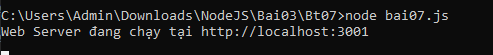
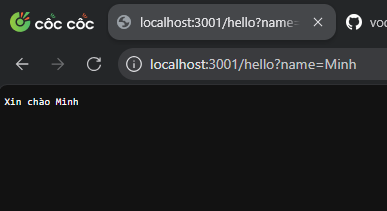
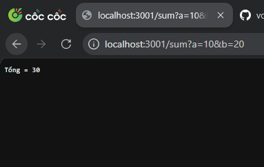

## 1. Nội dung bài tập

- Sử dụng module `http` và đối tượng `URL` trong Node.js.
- Tạo Web Server tại cổng `3001`.
- Xử lý tham số URL với hai chức năng:
  - `/hello?name=Minh`: Hiển thị `Xin chào Minh`.
  - `/sum?a=10&b=20`: Hiển thị `Tổng = 30`.
- Kiểm tra tham số bị thiếu hoặc giá trị không hợp lệ.

## 2. Các lệnh thực hiện

**Bước 1: Di chuyển vào thư mục Bt07**

```cmd
cd C:\Users\Admin\Downloads\NodeJS\Bai03\Bt07
```

**Bước 2: Tạo file bai07.js**

```cmd
notepad bai07.js
```

**Bước 3: Chạy chương trình**

```cmd
node bai07.js
```

**Bước 4: Truy cập Web Server**

- `http://localhost:3001/hello?name=Minh`
- `http://localhost:3001/sum?a=10&b=20`

**Bước 5: Kiểm tra lỗi**

- `http://localhost:3001/hello`
- `http://localhost:3001/sum?a=10`
- `http://localhost:3001/sum?a=abc&b=20`

## 3. Hình ảnh thực hiện

### Ảnh 1: Các bước thực hiện và khởi động Server



### Ảnh 2: Kết quả chào người dùng



### Ảnh 3: Kết quả tính tổng



## 4. Kết luận

Đã hoàn thành bài thực hành xử lý tham số URL trên Web Server bằng Node.js, sử dụng module `http` và đối tượng `URL`. Chương trình chạy tại cổng `3001` và xử lý các trường hợp hợp lệ, không hợp lệ theo yêu cầu.